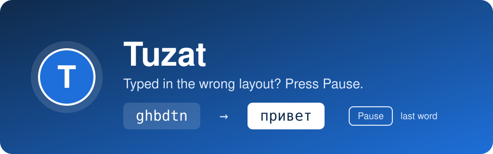

<p align="center">
  
</p>

<p align="center">
  <a href="https://github.com/abdumalikyaqub/tuzat/releases/latest"></a>
  <a href="https://github.com/abdumalikyaqub/tuzat/actions/workflows/ci.yml"></a>
  <a href="https://github.com/abdumalikyaqub/tuzat/releases"></a>
  
  
  <a href="LICENSE"></a>
</p>

<p align="center">
  <b>Fix text typed in the wrong keyboard layout with one key.</b><br>
  A small, open-source and privacy-first alternative to Punto Switcher for Windows.
</p>

---

You type a word, look at the screen, and see `ghbdtn` instead of `привет`. The layout was wrong again.
With Tuzat you do not delete and retype. You press **Pause**, and the word is fixed and the layout is switched.

*Tuzat* means "fix it" in Uzbek.

## Features

- **Fix the last word.** Press `Pause`. Press it again to undo.
- **Fix selected text.** Select any text and press `Shift+Pause`. Multi-line text works too.
- **Switches the layout for you**, so you can continue typing.
- **Any pair of layouts.** English and Russian by default. The character table is read from Windows, so other pairs such as Ukrainian, Kazakh, Tajik or Uzbek Cyrillic are supported too (tested so far: English and Russian).
- **Manual only.** No guessing and no surprise corrections while you type.
- **Private by design.** No network access, no telemetry, nothing you type is written to disk.
- **Clipboard-safe.** Your clipboard content comes back after `Shift+Pause`, and the temporary text stays out of the Win+V history.
- **Lightweight.** Lives in the tray, needs no admin rights, installs per user.
- **English and Russian UI**, chosen from your Windows language.

## Install

1. Download `Tuzat-Setup-<version>.exe` from the [latest release](https://github.com/abdumalikyaqub/tuzat/releases/latest).
2. Run it. No admin rights are needed. Tuzat is installed to `%LocalAppData%\Programs\Tuzat`.
3. Look for the blue **T** icon in the tray.

> **"Windows protected your PC"?** The installer is not code-signed yet, so SmartScreen shows a warning for new downloads.
> Click **More info → Run anyway**. You can check the file against `SHA256SUMS.txt` in the release:
> `Get-FileHash .\Tuzat-Setup-0.9.0.exe -Algorithm SHA256`

## Usage

| What you did | What you press | Result |
|---|---|---|
| Typed `ghbdtn` | `Pause` | `привет`, layout switches to Russian |
| Typed `руддщ` | `Pause` | `hello`, layout switches to English |
| Pressed `Pause` by mistake | `Pause` again | The word is back as it was |
| Selected `Ghbdtn? vbh!` | `Shift+Pause` | `Привет, мир!` |
| Nothing typed yet | `Pause` | Only the layout switches |

Right-click the tray icon for **Pause**, **Start with Windows**, **Open settings**, **Reload settings** and **Exit**.

## Settings

The settings file is `%AppData%\Tuzat\settings.json`. Open it from the tray menu, edit it, and choose **Reload settings**.

```json
{
  "fixLastWord": "Pause",
  "fixSelection": "Shift+Pause",
  "layouts": ["00000409", "00000419"],
  "clipboardRestoreDelayMs": 200
}
```

| Setting | Meaning |
|---|---|
| `fixLastWord`, `fixSelection` | Hotkeys. Modifiers: `Ctrl`, `Alt`, `Shift`, `Win`. Keys: `Pause`, `ScrollLock`, `Insert`, `Space`, `F1`–`F24`, `A`–`Z`, `0`–`9`. Example: `Ctrl+Alt+F12`. Letters, digits and `Space` need `Ctrl`, `Alt` or `Win`. |
| `layouts` | The two keyboard layouts to switch between, as layout IDs (KLID). |
| `clipboardRestoreDelayMs` | How long to wait after pasting before the clipboard is restored, from 50 to 2000 ms. Increase it if a slow app pastes the old clipboard content. |

Comments and trailing commas are allowed. If a value is wrong, Tuzat uses the default for it and shows a tray notification.

### Layout IDs

| Layout | KLID |
|---|---|
| English (US) | `00000409` |
| Russian | `00000419` |
| Ukrainian | `00000422` |
| Belarusian | `00000423` |
| Kazakh | `0000043F` |
| Kyrgyz | `00000440` |
| Tajik | `00000428` |
| Uzbek (Cyrillic) | `00000843` |
| German | `00000407` |
| French | `0000040C` |

To see the layouts installed on your PC, run this in PowerShell. The KLID is the part after the colon:

```powershell
(Get-WinUserLanguageList).InputMethodTips
```

## FAQ

**Is it a keylogger?**
No. Tuzat needs a keyboard hook to see the last word, but it keeps at most 64 key presses in memory, only for the current word. It has no network code and never writes typed text to disk or logs. The code is small and open: see [docs/ARCHITECTURE.md](docs/ARCHITECTURE.md).

**My antivirus or company EDR complains.**
Any program with a global keyboard hook can look suspicious to security tools, especially an unsigned one. You can build Tuzat yourself from source (see below). On a work computer, ask your IT team first.

**Does it fix words automatically?**
No, and this is on purpose. Tuzat changes text only when you press the hotkey.

**Does it work in every app?**
It works in normal desktop apps: browsers, Office, VS Code, messengers, Notepad. See the limitations below.

## Known limitations

- Windows started "as administrator" are not supported (Windows blocks input from normal apps into them).
- In some terminals and games, the layout switch may not work.
- **`Shift+Pause` sends `Ctrl+C`.** In a terminal with nothing selected, this stops the running command. In VS Code with nothing selected, `Ctrl+C` copies the whole line: turn off `editor.emptySelectionClipboard` or always select text first.
- `Shift+Pause` pastes plain text, so formatting (for example in Word) is lost.
- Password fields cannot be detected reliably. Key presses there are also kept in memory for the current word.
- Clipboard formats with delayed rendering may not come back after `Shift+Pause`.

## Build from source

You need the [.NET 10 SDK](https://dotnet.microsoft.com/download/dotnet/10.0). For the installer you also need Inno Setup 6.

```powershell
git clone https://github.com/abdumalikyaqub/tuzat.git
cd tuzat
dotnet test
dotnet run --project src/Tuzat.App
```

Build the installer:

```powershell
winget install --id JRSoftware.InnoSetup --exact
./build.ps1
```

The result is `artifacts/Tuzat-Setup-<version>.exe`.

## Contributing

Bug reports, ideas and pull requests are welcome. Please read [CONTRIBUTING.md](CONTRIBUTING.md) first.
If Tuzat saves you time, please star the repository: it helps other people find it.

## License

[MIT](LICENSE)
